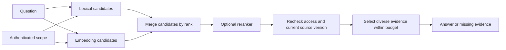

# Lexical, vector, hybrid, and reranking

Choose a search pipeline and measure which stage loses the answer.

Start with idea.md, then example.md, trace.md and failure.md. Try practice before answers.

Remember: **Find candidates. Order candidates. Pack evidence. Debug each separately.**