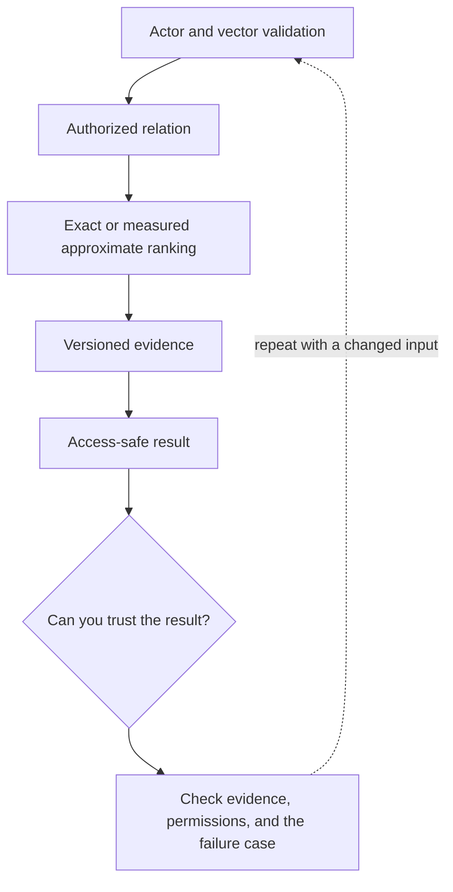

# 6. PostgreSQL and pgvector in a Rails data boundary

**Intermediate · about 2 hours including practice**

Store versioned vectors and run scoped retrieval without letting similarity bypass access.

Read idea → example → trace → failure. Then attempt practice/repair.md and practice/transfer.md.

Answers are separate in answers/. The app also provides prediction, quiz, recall, and optional AI review.

- [pgvector reference](https://github.com/pgvector/pgvector)
