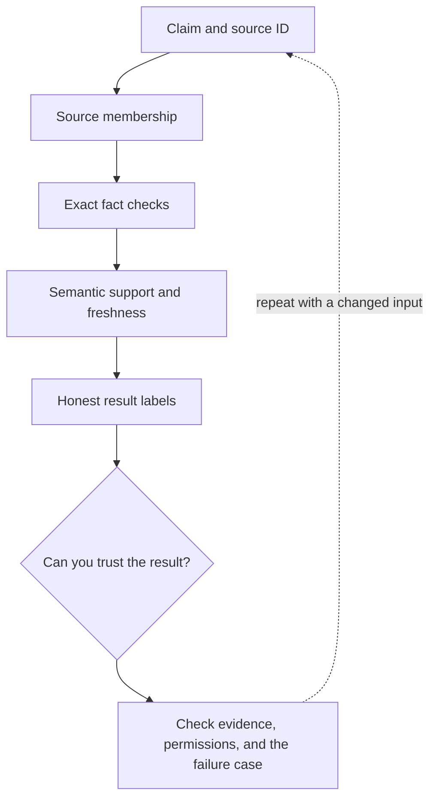

# 7. Grounding, citations, and the support gap

**Intermediate · about 2 hours including practice**

Distinguish source membership, claim support, freshness, and authority.

Read idea → example → trace → failure. Then attempt practice/repair.md and practice/transfer.md.

Answers are separate in answers/. The app also provides prediction, quiz, recall, and optional AI review.

- [Retrieval-Augmented Generation](https://arxiv.org/abs/2005.11401)
- [Evaluation practices](https://developers.openai.com/api/docs/guides/evaluation-best-practices)
