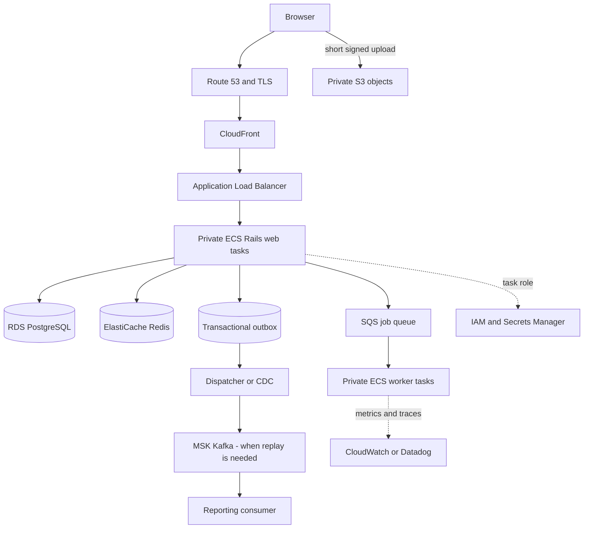

# Rails on AWS: setup and verification workbook

Use a separate training AWS account and short-lived login. Nothing in this course provisions cloud resources automatically. Replace placeholders in your own environment. Choose a region and a small budget before the optional hands-on work. Service prices and console layouts change; each chapter links to current official setup pages.

## Begin with the local adapter check

The complete Rails app lives at event-driven-systems/labs/rails-kafka. Its AttachmentUpload and QueueWorker files are also displayed in this lab. Run its AWS adapter tests with stub_responses. The SDK tests never use your credentials and never contact AWS.

```sh
# From event-driven-systems/labs/rails-kafka:
docker compose run --rm -e RAILS_ENV=test setup bundle exec rails db:prepare test TEST=test/aws_adapters_test.rb
```

## A useful first deployment path

Use ECS Fargate for the first managed-container deployment. Study EKS as an alternative when Kubernetes is actually needed. Use one Rails web image and the same image with a different worker command. Keep DB and Redis as managed state services. Add services only when their use case exists.



## Prepare identity and networking

1. Sign in through your chosen federated/SSO flow. Verify account, role, and region using sts get-caller-identity. Keep credentials outside source code.
2. Draw a VPC with two availability zones. Put the ALB in public subnets. Put Rails, DB, and Redis in private subnets. Choose NAT or VPC endpoints deliberately; they have costs and different coverage.
3. Define security-group paths: internet → ALB:443, ALB → Rails:3000, Rails/worker → DB:5432, Rails/worker → Redis:6379. Do not grant the database public inbound access.
4. Create separate task execution and application roles. Execution role pulls images/logs. Application task role grants only the required bucket prefix, queue, and secrets.

**Check:** distinguish IAM denial from a TCP timeout. Check resolved host, route, security groups, endpoint policy, identity policy, and resource policy at the boundary where the request fails.

## Database and image

1. Create the training RDS database with encrypted storage and an explicit backup/retention choice. Store credentials in Secrets Manager. Keep a rollback plan for schema changes.
2. Build a Linux-compatible image, push it to ECR, and use an immutable image digest in the task definition. Never bake credentials into layers.
3. Set RAILS_ENV, DATABASE_URL or its composed secret fields, connection pool, web/worker commands, task role, port, health endpoint, and log destination.
4. Run migrations once as a controlled task. Wait for completion before starting code that requires the new schema. Prefer an expand/contract migration for compatibility with rolling releases.
5. Create the web service and target group; check readiness, ALB health, then a real read/write request. Set a conservative initial desired count and a limit for scaling.

**Check:** total possible DB connections = web processes × threads × tasks + workers + deployment overlap + operator reserve. Scaling tasks can exhaust DB connections before CPU is full.

## Uploads and jobs

For S3: block public access, scope the task role to a training prefix, choose lifecycle cleanup, configure the browser's exact allowed origin/method/header, and issue a short signed PUT only after authorization. Verify object metadata and ownership before marking an attachment available. A signed URL is a temporary capability; avoid logging it.

For SQS: create the queue, choose Standard/FIFO from ordering/dedup requirements, configure visibility relative to processing time, and attach a redrive policy with a dead-letter queue. Deploy a worker that persists its business effect before deleting the receipt. Stop it once and observe redelivery. Repeat an event ID and prove a single durable effect.

**Check:** SDK stubs test call ordering. Real checks also need IAM, endpoint reachability, CORS (for browser S3), encryption permissions, queue settings, duplicate delivery, and cleanup.

## Observe and recover

Correlate request ID, ticket ID (synthetic), job/event ID, queue age, error class, and DB timing. Avoid sensitive payloads. Alert on user-visible symptoms and queue age with a runbook. Verify a backup by restoring into a separate training database and comparing known rows. A green deployment and a backup checkbox are not recovery proof.

## Cleanup checklist

Keep an inventory as you create resources. Delete training services/tasks, load balancers, NAT gateways/endpoints if unneeded, databases/snapshots you intentionally no longer need, queues, bucket contents/versions, repositories/images, log groups, and unused DNS resources according to the account policy. Inspect remaining billable resources. This worksheet itself creates none.
