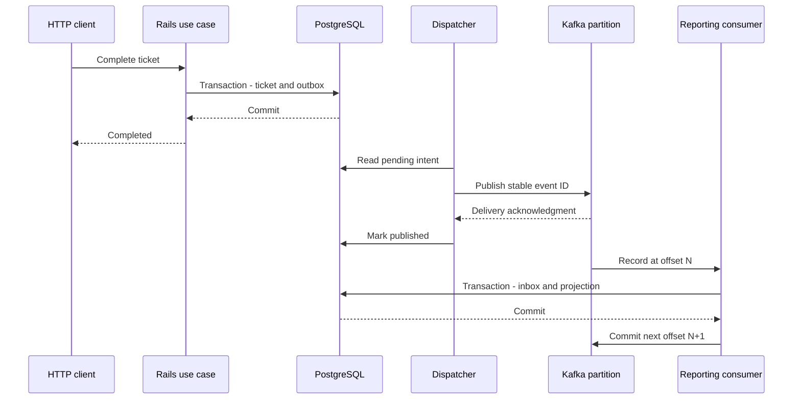

# Rails → outbox → Kafka → reporting

**Isolated modern lab:** Ruby 3.3.6, Rails 7.2.2.2, rdkafka 0.20.0, Kafka 4.1.0 KRaft, PostgreSQL 16.6. The work project's Ruby 2.7 / Rails 4.2 stack is different. Keep the idea; check client and framework compatibility before adapting it.

The example contains fresh synthetic support-ticket code. Run commands **inside this folder**. Docker Compose creates the `learning-event-lab` project. It does not create AWS resources. The HTTP endpoint binds to localhost and has no authentication. This is a mechanism lab, not a deployment template.

## Start and follow one event

```sh
docker compose up --build -d
curl http://127.0.0.1:3300/health
curl -X POST http://127.0.0.1:3300/tickets/1/complete
curl http://127.0.0.1:3300/tickets/1
docker compose logs --tail=40 dispatcher consumer
```

The GET eventually returns projection_count:1. Repeat the POST. It stays one. A repeated command creates no new completion fact. A repeated delivery uses the same event ID, so the inbox prevents a second DB effect.



## File map: read in this order

1. config/routes.rb and tickets_controller.rb: HTTP enters here.
2. complete_ticket.rb: lock ticket; state and intent share one transaction.
3. ticket_event.rb: versioned envelope, stable ID, aggregate key.
4. outbox_dispatcher.rb and kafka_publisher.rb: publish, wait, mark. A crash after publish can repeat delivery.
5. reporting_consumer.rb: parse, apply, store next offset, commit.
6. apply_reporting_event.rb and the migration: unique inbox and projection share one transaction.
7. test/: command repeat, rollback, publish failure, delivery repeat, partial-effect rollback, schema rejection, HTTP path, and AWS adapter stubs.

## Run checks

```sh
docker compose run --rm -e RAILS_ENV=test setup bundle exec rails db:prepare test
python3 smoke.py
```

The Rails tests use event_learning_test. The live smoke creates fresh tickets, completes a ticket twice, publishes the same envelope twice, stops the consumer, and verifies catch-up after restart. No real user data is used.

## Debug the boundaries

Stop dispatcher. Complete a fresh ticket. The outbox row should exist while the projection does not. Restart dispatcher. Match event_id across the relay and consumer logs. Stop consumer. Kafka retains its records up to the retention limit. Restart before that limit and inspect catch-up.

```sh
docker compose stop consumer
docker compose start consumer
docker compose exec kafka /opt/kafka/bin/kafka-consumer-groups.sh --bootstrap-server kafka:9092 --describe --group reporting-v1
```

Read group, topic, partition, committed offset, log end, and lag together. Lag is a record count. Event age measures how long a business result has been waiting. Use both.

A consumer can commit its DB transaction and crash before committing Kafka progress. The repeated event is harmless to this DB effect because of the inbox. Sending an email outside the DB transaction would need a different idempotency/reconciliation boundary.

## Assumptions to challenge

There is one serial dispatcher and one consumer process. One broker cannot demonstrate broker failover or controller quorum resilience. The ticket has one completion transition. This keeps the mechanism visible. Parallel dispatch, event ordering across retries, poison records, schemas, auth, retention/privacy, and projection rebuilds need explicit policies before a real release.

Rails 4.2 uses different migration and autoloading APIs. rdkafka 0.20.0 requires modern Ruby. Do not paste these files into the legacy work project.

## AWS seams in the same training app

AttachmentUpload chooses a server-owned S3 key and signs a five-minute PUT. A real endpoint must authorize the ticket and attachment purpose first. QueueWorker deletes an SQS receipt only after the handler succeeds. That handler still needs durable idempotency. Tests use AWS SDK stub_responses and make no AWS calls. Stubs cannot prove IAM, CORS, routing, or real service behavior. The AWS track provides a setup worksheet for those checks.

## Stop

```sh
docker compose down
```

This stops this lab's services. Its named PostgreSQL volume remains for later inspection. No global Docker prune is needed.

## Lab storage lifetime

PostgreSQL uses a named volume. In this small lab the Kafka log is kept in the broker container's writable layer. A stop/start keeps it; removing/recreating the broker container loses its local log, even though the DB volume remains. Use fresh synthetic tickets after recreating the stack. Existing projection rows are not proof that old Kafka history survived. A durable deployment needs explicit persistent broker storage, replication, retention, and recovery checks. The replay capstone asks you to reconcile exactly this kind of mismatched timeline.
