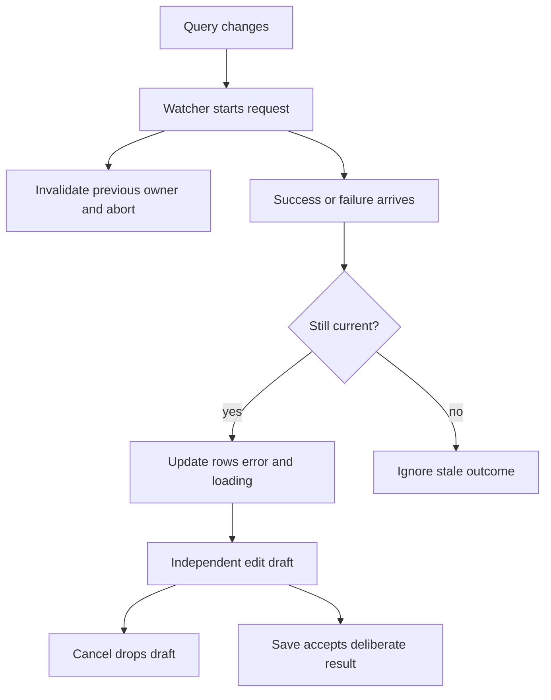

# Vue 3 ticket workspace

A complete small Vue 3.5 app with synthetic in-memory data. Use Node 22.12+ or the same Node 24 runtime as the learning app. It makes no work or cloud requests.

```sh
npm ci
npm test
npm run build
npm run dev
```

Open localhost:5174. Search. Edit a title. Cancel. Search again. The data resets on reload because this lab teaches state ownership, not persistence.

## Read the files in this order

1. api.ts: outside boundary and abortable synthetic search.
2. useTicketSearch.ts: request-local active flag, cleanup, and guarded rows/error/loading.
3. TicketWorkspace.vue: local draft ownership, labels, status, cancel/save.
4. TicketWorkspace.test.ts: controlled promise order; no arbitrary sleep to test races.



## Practice before looking at tests

Make the old request fail after the new one succeeds. What should the alert show? Make the old request finish while the new one is waiting. Should the spinner stop? Edit a title and Cancel. Does the saved list change? State the answer before running.

The tests check component behavior through DOM interactions. They do not prove keyboard/screen-reader behavior, real backend permissions, or browser layout. Use the frontend and UX capstone checklist for those. Next: add optimistic concurrency, a proper empty/error retry action, focus restoration, and API persistence in a separate practice branch.
