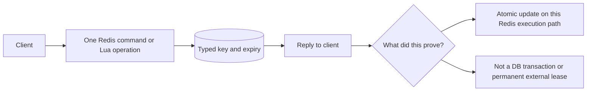

# Redis: choose a data type, then check its failure boundary

This separate Docker Compose project uses Redis 7.4.2 and localhost port 16379. It never connects to a work Redis instance. The Python standard-library client is intentionally small: it teaches the RESP boundary, not a full production driver.

```sh
docker compose up -d --wait
python3 lab.py
docker compose down
```

The script uses a random learning key prefix. It checks hashes, leaderboard order, concurrent INCR, a deliberately lost GET/SET update, expiration, token-checked lease release, a Lua counter-plus-expiry, and stream acknowledgment. It deletes only that run's keys. Data for this lab lives in its own named volume.

## Predict before running

1. Eight clients increment 100 times each. What total should INCR preserve?
2. Two clients read 800, then each writes 801. Why is the result not 802?
3. A's lease expires. B takes it. Should A be allowed to delete B's key?
4. XACK succeeds. Does the stream record disappear?

Write your answers before opening lab.py. Change one condition after the first run. Explain the observed result in the practice page.



A successful Redis lock is not permission to write forever. A paused owner can resume after expiry. Protect a resource with a fencing/version protocol when stale owners would cause harm. Redis availability, eviction, persistence, and topology also affect the design. The course separates cache state from durable business authority.

## Trace a stale cache fill

Reader loads DB version 1. Writer commits version 2 and deletes the cache. Reader then fills the cache with version 1. The delete happened, yet stale data returned. Draw that order. Add a bounded TTL, version-aware fill, or a read path that checks the authoritative version according to the business requirement. A TTL bounds age in some paths; it does not make stale permissions acceptable.

For a real service, use a maintained client, connection timeouts/pools, namespaced keys, defined eviction/persistence, and separate latency/correctness tests. This lab cannot prove multi-node failover behavior.
